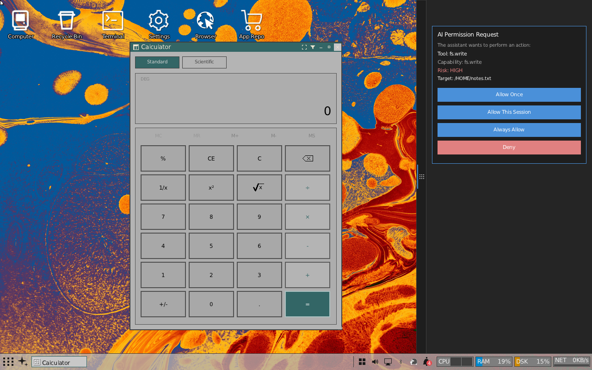
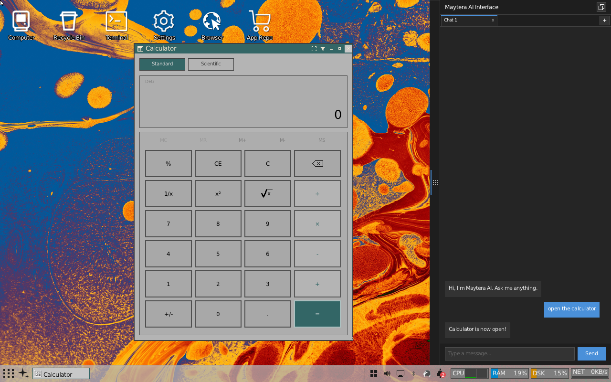
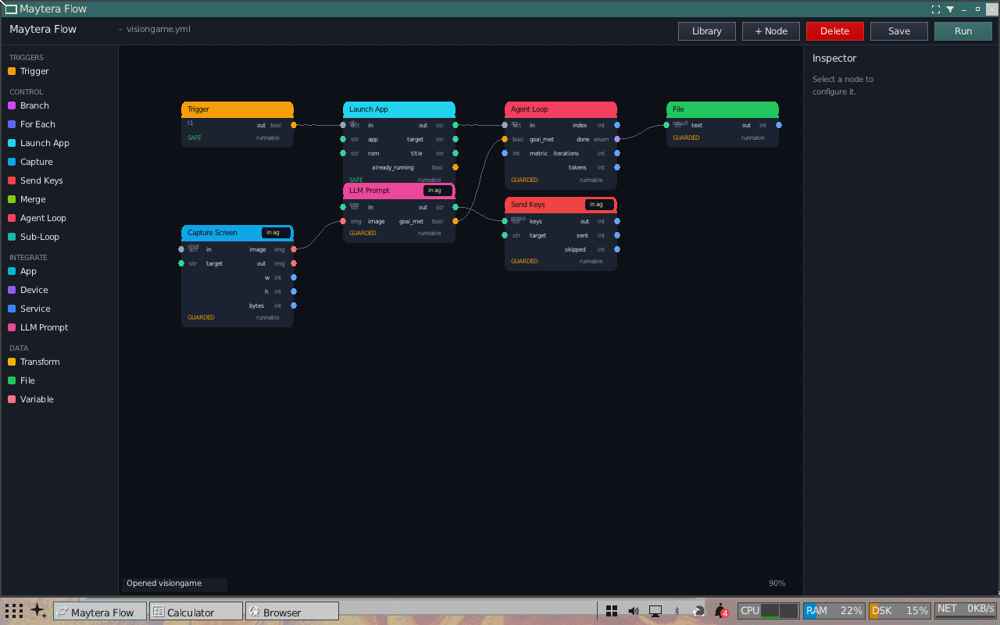
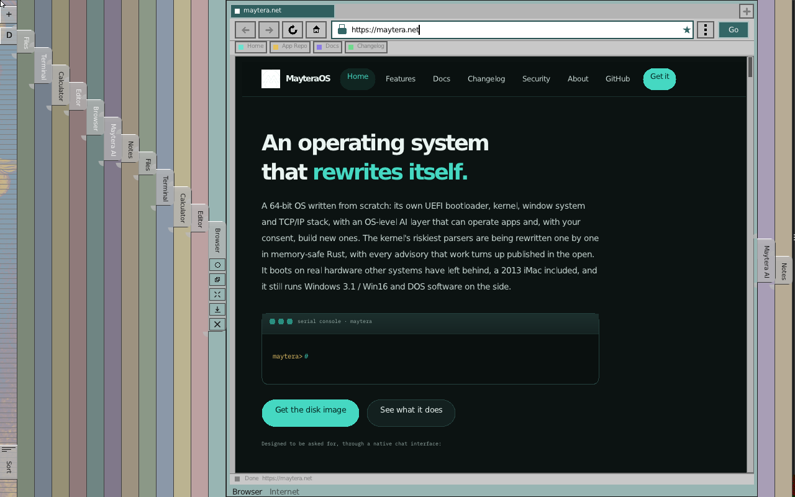
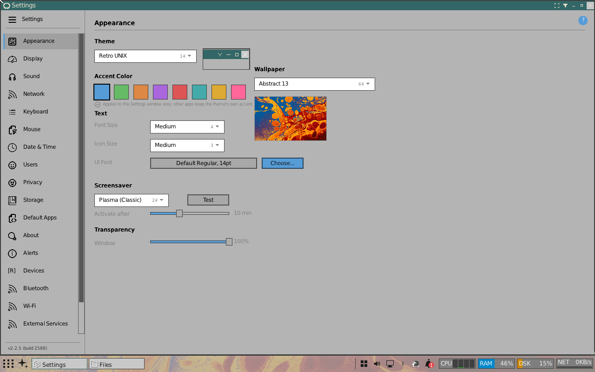
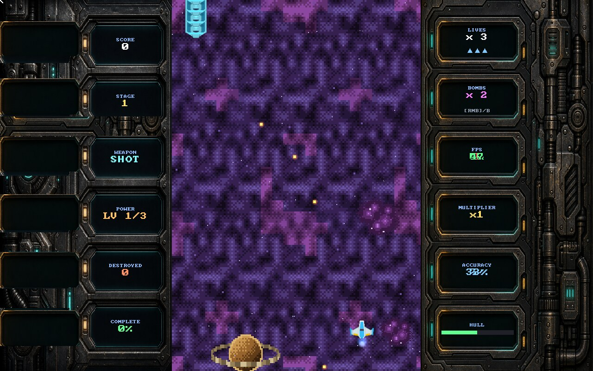
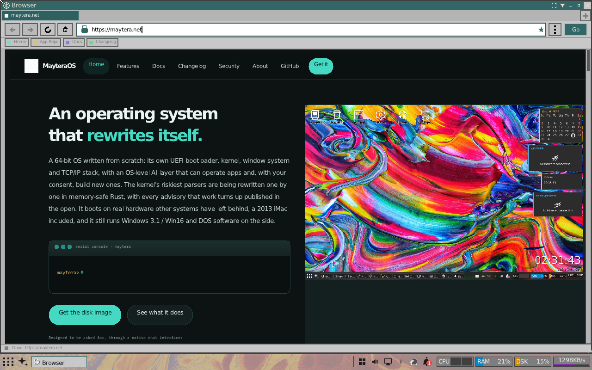
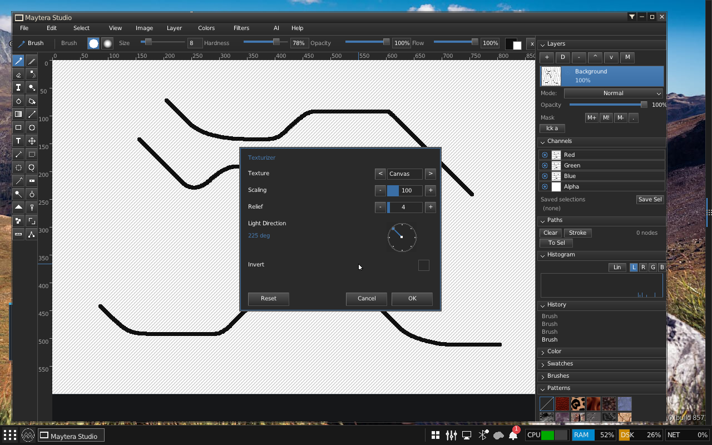

# MayteraOS

**MayteraOS is an LLM-first operating system, built from scratch.**

The AI layer is not an app bolted on top. The OS declares a typed **tool
surface** for the model to call, applications publish machine-readable **tool
contracts** that expose their own controls to it, and a built-in assistant uses
both to operate the desktop: launching apps, reading and writing files, changing
settings, driving another app's controls, capturing the screen, and generating a
workflow or a whole application from a description. Every action is classified
by risk. A high-risk one stops at an on-screen **consent prompt**, is scoped by a
**capability token** if you allow it, and is written to an **audit log** either
way. Three of those capabilities are enforced by the kernel, which refuses the
syscall outright when there is no grant.

That paragraph is the pitch, so **The AI layer** below states what is
implemented, what is partial and what is still scaffolding, naming the file
each claim is checkable in.

Underneath it sits a complete operating system, written with heavy AI
assistance: its own UEFI bootloader, a freestanding C and Rust kernel (demand
paging, copy-on-write, a preemptive scheduler), a compositor desktop, an
in-house TCP/IP and TLS 1.3 stack, ext2 and FAT filesystems, and a suite of
native applications. It boots on real x86-64 hardware and in virtual machines.

> Status: an ambitious, experimental research OS under active development. It
> boots to a usable desktop, but it is experimental software. Do not run it on
> production hardware or a network you care about.


**This repository is version 2.0.2, kernel build 2285.** The published release
`v2.0.2-b2285` is built from this source at the commit it is tagged on, so the
number in `kernel/version.h` and the number stamped on the downloadable image
are the same one. See Releases below.

## Screenshots

| | |
|---|---|
|  |  |
| The assistant asked to write a file. Every high-risk action stops here first, naming the tool, the capability, the risk class and the exact target path | Maytera AI, docked on the right edge and asked to open the Calculator. It did |
|  |  |
| Maytera Flow: a workflow as a node graph, with each node badged `SAFE`/`GUARDED` and `runnable`/`editor-only` | Cardfile, an alternate desktop shell. No taskbar, no start menu, no icons: apps are cards in a Rolodex deck, waiting as sideways tabs down the left edge, and the open card's body is the application's own window |
|  |  |
| Settings, drawn with the shared style engine and antialiased TrueType text | Maytera Squadron, an original arcade shooter written for the OS |
|  |  |
| The browser rendering <https://maytera.net>. Captured on an internal build: **the browser does not build from a clean clone of this repository**, so it is absent from the published image (see Building) | Maytera Studio, the image editor, with the Texturizer filter dialog open |

## Highlights

- **LLM-first architecture** - a 29-tool OS surface the assistant can call,
  plus per-app **tool contracts** that expose an app's own controls to it, a
  **capability token** on every high-risk action, a consent prompt before it
  runs, and an audit line afterwards whichever way you answered. Fifteen apps
  declare a contract today, not all of them. There is deliberately **no
  prompt-injection detector**; see Security below for what is actually enforced
  and why. The AI layer has its own section below, including the parts that are
  still scaffolding.
- **Kernel** - long-mode paging with demand paging and copy-on-write, a
  preemptive scheduler, ELF and PE loaders, signals, futexes, and a
  wait-queue-based blocking layer.
- **SMP is on by default.** Every detected application processor is started
  and takes user work, not just the bootstrap processor. An empty
  `/NOSMPSCHED.TXT` on the ESP forces it off for one boot with no rebuild, for
  a machine that needs that.
  **It is not yet a performance win, and it is not described as one.** A Big
  Kernel Lock still serialises the kernel, so on the project's own rig the
  SMP-on arm trails the SMP-off arm by about 26% in frames presented per
  second. What is gone is the old collapse with core count, where throughput
  fell monotonically from 1 to 8 cores; it is now flat. Narrowing the lock is
  its own piece of work rather than something hidden behind a disabled
  default. `kernel/cpu/smp.c` carries the current state of it.
- **Graphics and desktop** - a framebuffer compositor with damage-tracked
  redraw, drop shadows, antialiased TrueType text, a themeable style engine and
  desktop widgets.
- **Applications** - Files, Terminal, Settings, a text editor, calculator,
  image viewer, an IRC client, a music player, Task Manager, an App Store
  client, a first-boot setup wizard, **Maytera AI** (the assistant),
  **Maytera Flow** (a node-graph workflow editor and its runner), and
  **Maytera Studio**, an image editor with layers, masks, blend modes,
  channels, paths and a large filter set. A web browser exists in the tree but
  does not build from a clean clone, so it is not on the published image; see
  Building.
- **Two desktop shells, and the panel is not the only choice.** The default is
  a classic taskbar, with four more panel layouts selectable in Settings
  (Lumina, a CDE/Motif-style UNIX front panel, a retro top bar, and a glass
  dock). **Cardfile** replaces the shell outright: no taskbar, no start menu
  and no desktop icons, just a Rolodex deck where each app is a card with a
  sideways tab and the open card's body *is* the application's window.
- **Games** - solitaire, chess, Lemmings, Pong, Snake, Angband, a roguelike, a
  Frotz interpreter for Infocom-era text adventures, a Game Boy emulator, and
  an original arcade shooter, Maytera Squadron, among others. Several larger
  engine ports, DOOM included, are distributed through the MayteraOS App Store
  instead of from this repository, so that each one can carry its own licence
  text; see Licensing. **No third-party game data ships here at all**, so a
  port that needs a commercial data file wants yours.
- **Rust in the kernel** - an incremental port. The kernel build currently
  enables 49 `RUST_*` switches (see `kernel/Makefile`), covering the IP, TCP
  and UDP checksums, the ext2 directory parser, the ICMP/ARP/DNS/DHCP/URL
  parsers, the ELF and PE loaders, the FAT/exFAT/ISO9660 readers, the
  BMP/PNG/JPEG/inflate decoders, several hashes and ciphers, TLS record
  parsing, the syscall argument table, and the clipboard. Each ported piece
  keeps its C original for rollback and is checked against it with a
  differential test. See `kernel/RUST_PORT_LEDGER.md`, which records the honest
  per-component status including where a result was weaker than it first
  looked.
- **Networking + filesystems** - an in-house TCP/IP stack (ARP, IP, UDP, TCP,
  DHCP, DNS), TLS 1.3 with certificate and signature validation, SSH
  client/server; ext2 and FAT32 (VFAT long names) behind a VFS.
- **Compatibility layers** - a Win16 (Windows 3.x NE) interpreter and a DOS
  layer. These are *runtimes*, not bundled software: they run applications you
  supply yourself. **No third-party application ships with this repository.**

Where things are partial, they are marked partial rather than dressed up. The
browser's JavaScript is a ported Duktape, so it is ES5.1-era with no event
loop: it evaluates scripts but does not drive an interactive, event-driven page.
The command-line utilities under `userland/apps` are minimal reimplementations
rather than POSIX-complete ones: `sed` does a literal `s/find/replace/[g]` with
no regular expressions, `tr` maps single characters with no ranges or classes,
and there is no `grep` in this release at all.

**The published image does not ship Python 3.** The `python` app in this
repository is a small built-in interpreter that shares the name and nothing
else: `userland/apps/python/Makefile` builds one `main.o` (1286 lines of C)
against the freestanding libc. The real interpreter on the project's internal
image is CPython 3.11.9, and what this repository carries for it is the port
LAYER only - `userland/apps/python/port/` holds the MayteraOS launcher, the
compatibility shims, five diffs and the link recipe, and says in its own
`README.md` that the upstream CPython source "is not vendored here".
`userland/python/` is an older experiment that its own `README.md` marks
superseded. A row in `ATTRIBUTION.md` still calls that tree a MicroPython port;
it is the legacy tree, not the shipping interpreter.

## The AI layer

This section is long because it is the part most easily overstated. Everything
below names the file it is checkable in.

### The tool surface: what the model is allowed to call

The assistant does not have a shell. It has a fixed, typed list of **29 tools**,
declared once in `userland/libc/aitools.def` as an X-macro table:

```c
AI_TOOL("fs.write",
        "Create, overwrite or append to a file. args {path:string, content:string, mode:'overwrite'|'append'}. cap fs.write, HIGH risk (asks consent).")
  AI_ARG("path", AI_T_STR, 1)
  AI_ARG("content", AI_T_STR, 1)
  AI_ARG("mode", AI_T_STR, 0)
```

That one table is expanded into three things that therefore cannot drift apart:
the tool block in the system prompt, the native tool-calling schema sent to the
provider, and `/AITOOLS/INDEX.YAML` on the image, generated by
`tools/aitools-index`. The generator has a `--check` mode that reads
`userland/libc/aiclient.c` and fails if the advertised list and the dispatcher
disagree in either direction, and the image build refuses to ship a stale index
rather than carrying one forward. The point of generating all three from one
table is that the model can never be offered a tool the dispatcher does not
have, or miss one it does.

### Per-app tool contracts

A **tool contract** is an app's own answer to "what can be done to you, and what
does it cost". It is a `ct_contract_t` table (`userland/libc/contract.h`) that
the app either writes out statically or **projects** from the same tables that
draw and hit-test its controls, which is the preferred form because completeness
is then structural rather than remembered.

It is not a file sitting next to the binary. The app answers on its own command
line, from the same table that draws its controls, **before it creates a
window**, and exits:

```
$ settings --contract probe
contract: settings items=24 source=static
$ settings --contract get clock.use_24hour
ok name=clock.use_24hour type=bool value=1
$ settings --contract set clock.use_24hour 0
ok name=clock.use_24hour prev=1 value=0
```

Verbs are `probe`, `list`, `describe`, `get`, `set`, `call`. `describe` emits
YAML, one flow map per row (`ct_describe()`, `userland/libc/contract.c`):

```
  - {name: <id>, type: <bool|int|enum|string|action>, access: <ro|rw|call>,
     risk: <SAFE|GUARDED|DENIED>, options|min|max, key: <c>, cap: <capability>,
     needs: [<kernel capability>:<scope template>|...], <terms>, desc: <text>}
```

`needs: []` is emitted even when empty, deliberately, so a consumer can tell "this
action reaches no kernel capability" from "nobody declared what it reaches".

There is a second delivery path that matters in practice. A `--contract` spawn
answers from a *fresh* process, so it can never touch a document you have open.
`contract_invoke_live()` (`userland/libc/ctlive.c`) delivers the same verb to an
instance already running with a window, which runs it against live state. Both
halves funnel through one `contract_run_verb()`, so the live path cannot answer
differently or skip the gate.

**How many apps have one: fifteen.** `browser`, `calc`, `convert`, `editor`,
`files`, `imageviewer`, `musicplayer`, `paint`, `settings`, `sheets`, `slides`,
`snapshot`, `terminal`, `timers`, `writer`. The rest of the apps in this
repository do not, and `tools/contract-lint/PROJECTION.tsv` is the project's own
ledger of that gap. Coverage is uneven inside the fifteen too: Calculator is 60
of 60 controls because its rows are projected from the same `std_btns[]` /
`sci_btns[]` arrays that draw the keys, while Settings is 19 of its 33
geometry-struct controls, and every shortfall carries a written justification in
`tools/contract-lint/COVERAGE.tsv` or the lint fails.

The index the caller resolves an app through is `/AITOOLS/CONTRACTS.YML`,
generated from source by `tools/contract-lint/contract-lint.py --emit-index`,
with a build gate that goes red if the file is missing or names a binary that is
not on the image.

**The honest limit of the "reads those contracts" claim.** The model is handed
the 29-tool index and the *list* of apps that have contracts. It is not handed
any app's contract rows except Settings'. There is no `app.describe` tool. So
`app.action` works when the model names an action that exists, and returns an
error naming the real apps when it does not. "Apps expose their controls to the
assistant" is true; "the assistant has read every app's contract" is not.

### Capability tokens

There are two mechanisms, and conflating them is how this gets oversold.

**1. The userland gate (`userland/libc/aicap.c`).** Every tool the model names
passes through one chokepoint, `aicap_authorize()`, before it is dispatched. Its
risk table has 39 entries, **23 of them HIGH**: `settings.set`, `fs.write`,
`fs.delete`, `fs.mkdir`, `fs.move` and the `files.*` aliases of those four,
`photos.organize`, `terminal.execute`, `python.execute`, `taskmanager.kill`,
`network.set`, `net.firewall`, `build.compile_app`, `build.deploy_app`,
`screen.capture`, `input.type`/`key`/`click`/`mouse`, and `snapshot.capture`. An
unknown tool id defaults to HIGH, so the gate fails closed. The 16 LOW entries
are the reads and the curated launches (`files.list`, `files.read`,
`settings.get`, `weather.current`, `storage.free`, `input.windows`,
`app.launch` and the like) and they run with no token. That is a deliberate
classification rather than an oversight, but it does mean "**every** action is
scoped by a token" would be wrong.

A token carries the capability (exact, like `fs.write`, or a wildcard like
`fs.*`), an optional list of allowed path prefixes, a TTL, a maximum use count
and an audit tag for bulk revocation. Contract invocations are authorized
through the same gate (`userland/libc/contract.c`), not a second one.

The ceiling on this is stated in the code's own threat model
(`userland/libc/aicap.h`) and is worth repeating here: **enforcement is
in-process userland.** A hostile Ring 3 binary does not call
`aicap_authorize()`. This gate constrains what the assistant does on your
behalf. It is not a sandbox.

**2. The kernel gate (`kernel/proc/caps.c`, `kernel/rustkern/caps.rs`).** This
one has teeth, and it is deliberately small. The syscall dispatcher checks a
capability at a single chokepoint, and exactly **five syscalls across three
capability classes** are refused without a grant:

| Capability | Syscalls gated |
|---|---|
| `screen.capture` | `SYS_SCREENSHOT_REQUEST` |
| `input.inject` | `SYS_CAP_INJECT_KEY`, `SYS_CAP_INJECT_KEY_UP`, `SYS_CAP_INJECT_MOUSE` |
| `serial.port` | `SYS_SERIAL_OPEN` |

Scope is checked in the handler, not just at the gate: a screen-capture grant
covers a path prefix, a serial grant covers a named port, an inject grant covers
a target window. Other capability names (`audio.output`, `net.connect`,
`net.listen`, `screen.stream`, `input.observe`) are *defined* so the set can be
enumerated honestly, and `cap_is_issuable()` **refuses to issue them** until
there is a first-party consumer. The ambient back doors were deleted rather than
merely checked: the `/SCREENSHOT.REQ` drop file is gone and `/DEV/TTYACM0` was
retightened from 0666 to 0600 (advisories in
[`kernel/SECURITY_ADVISORIES.md`](kernel/SECURITY_ADVISORIES.md)).

**3. One more kernel-side restriction, which is the strongest true statement
here.** `kernel/rustkern/escrowmark.rs` binds the AI binaries (`/APPS/AICHAT`,
`/APPS/AIDEMO`, `/APPS/AIBENCH`) into Recycle-only mode **at launch, by path,
before their first instruction**, with no syscall to clear it. A delete by the
assistant is redirected into the Recycle Bin and you are told on screen. The
assistant cannot destroy a file permanently, and that is not a policy it is
trusted to honour.

### The consent prompt

There are two, with different trust properties, and only one of them is drawn
by the compositor.

**The compositor-drawn prompt** (`userland/apps/compositor/capconsent.c`) is the
one that guards the kernel capabilities above. It draws a full-screen scrim so
nothing behind it looks interactive; its title is fixed chrome, `Permission
request`, and never contains app-supplied text, so the first thing you read is a
sentence the asking app could not write. It then shows one sanitised line
(`<App> wants to capture your screen.`), a scope line the **kernel** authored
(the save path, the port name, or the target window's real title), and a
duration. The footer is `[Enter] Allow   [A] Always   [Esc] Deny`. It is
keyboard-only: `capconsent_handle_mouse()` swallows clicks without acting, and a
250 ms settle window discards type-ahead so a buffered keystroke cannot approve
a prompt you have not read. `sys_cap_view` and `sys_cap_resolve` are
compositor-only in the kernel; any other app asking gets `CAP_EPERM`.

**The AI-Chat-drawn dialog** (`userland/apps/aichat/main.c`,
`draw_consent_dialog()`) handles the other HIGH-risk tools, the ones with no
kernel capability behind them. It is the one in the screenshot above: tool,
capability, red `Risk: HIGH`, the target, and four buttons - Allow Once, Allow
This Session, Always Allow, Deny. Closing the window denies; so does 180 seconds
of no answer. It is drawn inside the AI Chat window, so it does **not** carry the
compositor prompt's anti-spoofing properties, and it is mouse-driven.

A denial is not a retry prompt: the tool returns `CAPABILITY_DENIED` as the
observation and the system prompt instructs the model to stop rather than ask
again.

### The audit log

`<home>/CONFIG/AIAUDIT.LOG`, one pipe-delimited line per decision, allow or
deny:

```
<timestamp>|<tool>|<capability>|<args, sanitised and truncated to 200 bytes>|<ok|error|denied>|<low-risk|token:<id>|consent-granted|...>
```

It is written by the live path, not by a test harness: by the tool gate in
`userland/libc/aiclient.c` on both the allow and the deny branch, by every
contract invocation, by the device-manifest decisions in
`userland/libc/aidev.c`, and from fifteen sites in the Flow runner. Measurement
telemetry goes to a separate `AIMETRIC.LOG` on purpose, so a chatty benchmark
cannot evict authorization records.

**It is not append-only and it is not tamper-evident. Do not treat it as
evidence.** `log_append()` reads the whole file, truncates it and rewrites the
tail, capped at 32 KB, which is roughly the last 290 records. There is no HMAC,
no hash chain, no sequence counter. It is a plain text file in your own home
directory and you can delete it. The header says why that is the honest
ceiling: a process that declines to call the gate also declines to call the
logger, so tamper-evidence has to arrive with the enforcement point, not with
the file. The kernel's own `/CONFIG/SECURITY.LOG` is Ring-0-written and
Ring-3-unwritable, which is access control rather than tamper-evidence, and it
covers the kernel-gated class only.

### Generating and running new software

This is the claim that needs the most care, so here it is in pieces.

**Real:** the assistant can write a complete C application from a description,
the result is written to `/APPS/<name>` and launched, and the whole path goes
through the same consent gate and audit log as everything else. There is a
deterministic self-test driver in the AI Chat app that exercises
`build.compile_app` -> `build.deploy_app` through the real gate without the
model in the loop.

**Not on the device:** the compile step is an HTTPS POST to a build service.
`userland/libc/aiclient.c` defaults it to `https://127.0.0.1:8899/compile`,
overridable through `/CONFIG/BUILDSVC.TXT`. That service's source is not in this
repository, nothing in the image ships a `BUILDSVC.TXT`, and nothing is
listening on that port on a MayteraOS box, so out of the box `build.compile_app`
returns a network error. The API reference the model is supposed to write
against, `/AITOOLS/APPGEN.md`, does not exist either, and the build script says
so in as many words rather than shipping a placeholder.

**There is an on-device C compiler, and the AI does not use it.**
`userland/ports/tcc` ports TinyCC 0.9.27 as `/APPS/TCC`, with a runtime tree at
`/APPS/TCCLIB` carrying this project's freestanding `libc.a` and `crt0.o`, so a
program compiled on the machine has something to link against. There is not one
reference to it anywhere in the AI path. Wiring the two together is an obvious
piece of work that has not been done.

**No widget generation and no driver generation.** The tool table has exactly
two build tools and both are app-scoped. Any claim about the assistant writing
widgets or drivers is a claim about something that does not exist.

**What does work end to end with nothing external: workflow generation.**
`userland/apps/aichat/flowgen.c` turns a chat description into Maytera Flow YAML
and validates it with the **runner's own parser** before saving, so a malformed
flow is never written to disk. It has a host unit test. See the next section.

### Using it

Maytera AI is `/APPS/AICHAT`, Start menu -> Internet -> "Maytera AI". It docks
as a panel on the right edge of the screen, collapsing to a sliver, and can be
popped out into an ordinary window. `Super` + `Space` opens a prompt bar from
anywhere.

It needs a key. The provider is pluggable - eight presets ship (OpenAI,
Anthropic, Moonshot/Kimi, OpenRouter, Groq, DeepSeek, Ollama for a local model,
and Custom) and native tool-calling is auto-detected and disabled one way on a
provider that refuses it. The key lives per-user in `<home>/CONFIG/AISVC.CFG` at
mode 0600 and is set in **Settings -> External Services -> AI Provider (LLM)**.
Without one the app still opens and draws its full interface; it just tells you
to set a key instead of answering. (The in-app message points you at
"Settings > AI", which is wrong: there is no AI panel. The card is in External
Services.)

## Maytera Flow

Maytera Flow is a node-graph editor for dataflow workflows, plus a separate
headless runner that executes them. Two binaries, and the split is deliberate:
`/APPS/FLOW` (Start menu -> Accessories -> "Maytera Flow") never executes
anything, and every execution seam in the editor is a refusal that says `editor
does not execute nodes; use Run (/APPS/FLOWRUN)`.

A flow is a graph of typed nodes joined by edges, saved as YAML under
`<home>/CONFIG/WORKFLOWS` and parsed with the ported libyaml rather than a
hand-rolled reader. One of the seven bundled examples, verbatim:

```yaml
name: hello
description: "Manual trigger, constant, file write (the M1 hello example)"
nodes:
  - id: t1
    type: trigger
    params:
      kind: manual
  - id: x1
    type: transform
    params:
      op: constant
      text: "Maytera Flow M1 OK"
  - id: f1
    type: file
    params:
      op: write
      path: /HOME/FLOWOUT.TXT
edges:
  - from: [t1, out]
    to: [x1, in]
  - from: [x1, out]
    to: [f1, text]
```

Nodes run in topological order. **Eleven node handlers execute**, under twelve
type names: `trigger`, `transform`, `file`, `llm`, `foreach` (with `loop` as an
alias for it), `app`, `agent`, `subloop`, `capture`, `input`, `launch`. The palette offers five more - `branch`, `merge`,
`device`, `service`, `variable` - which round-trip through the file format and
have full inspector UI, but which the runner refuses with `unsupported node
type`. The editor does not hide this: every node card carries a risk badge
(`SAFE` / `GUARDED`) and the word `runnable` or `editor-only` along its bottom
edge, both legible in the screenshot above (the `visiongame` example uses only
executable types, so every card there reads `runnable`). The practical consequence is that a
runnable flow has **no conditional branching and no variables**; control flow is
`foreach`, `agent` and `subloop`.

What a flow can actually reach, and through what:

| Node | Mechanism |
|---|---|
| `app` | the tool-contract layer (`contract_invoke`), risk-classified and `aicap_authorize()`d before the spawn, then gated and audited again by the target app |
| `file` | ordinary syscalls behind `aicap_authorize("fs.write", path, ...)` |
| `capture` | the compositor's screenshot queue via `sys_screenshot_request()`, which is one of the kernel-gated capabilities above |
| `input` | `sys_cap_inject_key()` / `_key_up()` under a `CAP_INPUT_INJECT` grant, with the grant revoked if the target window is wrong, and press and release always paired |
| `llm` | the same shared AI client the assistant uses; it fails cleanly without a key rather than inventing a result |
| `launch` | the shared launch registry, the same `.MENU` manifest the Start menu reads; it waits for the window and is idempotent |

So a flow reaches other apps, the screen, the keyboard and a model, and every
privileged step goes through the gate and the audit log described above. It does
**not** shell out.

**Flows are started by hand.** The Run button or `r` in the editor, `/flow run
<name>` in AI Chat, or `/APPS/FLOWRUN <name>` directly (with no argument it runs
every saved flow and logs the results). **There is no scheduler and no event
trigger**: a `trigger` node with `kind: cron` parses, is accepted, and then does
not fire - the runner logs that it would be registered with a scheduler and
returns nothing, because the project would rather have a documented gap than a
faked one. Nothing on the image invokes the runner on a timer. Calling this
"workflow automation" would overstate it; it is workflow authoring and on-demand
execution.

Known limits, stated so you do not discover them halfway through a graph: 64
nodes, 128 edges, 16 parameters per node, 512-byte values, 1024 loop iterations.
A `subloop` in `mode: async` runs its body sequentially and says so at runtime;
parallel execution is a TODO. The editor spawns the runner detached and reports
only `Launched /APPS/FLOWRUN <name>`, so results come from the side effect or
from the runner's own output, not from the editor. Authoring needs a mouse:
keyboard-only you can browse the library (`l`), open, zoom (`+`/`-`), save (`s`)
and run (`r`), but adding a node and editing a parameter are mouse paths.

The editor can also fetch more flows over the network. That feed is a signed
JSON manifest verified against the kernel-baked OTA public key, each entry
sha256-checked, and then parse-validated with the runner's own parser before a
byte is written to disk.

## Security

Defects this project has found and closed are published: the ledger is
[`kernel/SECURITY_ADVISORIES.md`](kernel/SECURITY_ADVISORIES.md) and the same set is
presented at <https://maytera.net/security>. `SECURITY.md` has the threat model, the
reporting route, and the known-weakness list.

This section states what is actually implemented, and what is not. Several
neighbouring features are easy to confuse with each other, so they are listed
separately rather than summarised as "hardened".

**Implemented and live:**

- **Userland PIE with load-base randomisation.** `kernel/exec/elf.c`
  randomises the load base of every PIE user image, drawing from the kernel
  HMAC-DRBG.
- **Stack canaries.** The kernel builds with `-fstack-protector-strong
  -mstack-protector-guard=global`, and `__stack_chk_guard` is seeded with a
  real random value at boot rather than left at a constant.
- **An image-wide W^X / ELF-shape gate.** Every launched binary is checked
  against exactly the rule the kernel's own loader enforces, encoded once in
  `tools/elf-shape-check.sh` so the gate and the loader cannot drift apart. It
  has a self-test that proves it goes red on a bad shape.
- **TLS 1.3 with certificate *and* signature validation.** Skipping either was
  a real gap once; it is closed.
- **Capability tokens, consent gating and an audit log** for AI-initiated
  actions. The AI layer section above says exactly which actions are token
  scoped, which of the two consent prompts guards which, and why the log is
  deliberately NOT described as append-only or tamper-evident.
- **No shipped default credentials.** `create_defaults()` in
  `kernel/proc/users.c`, the function that used to mint `root`/`root` and
  `admin`/`admin`, sits behind `MAYTERA_SHIP_DEFAULT_ACCOUNTS`, and no public
  or release build defines it. A fresh install therefore has an empty user
  database, and the login gate goes to first-boot account creation
  (`LOGIN_STATE_CREATE_ACCOUNT` in `kernel/gui/login.c`), which mints the
  administrator account from a username and password you choose. The
  compositor also spawns the setup wizard, `/APPS/SETUP`, when
  `/CONFIG/SETUPDONE` is absent. Autologin ships disabled in
  `disk/CONFIG/LOGIN.CFG`, so an image staged from this tree stops and asks you
  to create an account.

**Fixed in kernel build 2246: three Ring-3 privilege-boundary holes.** Each one
let a user process reach state it did not own, each was demonstrated with a
working proof before it was fixed, and each fix is the Rust module named beside
it. If you are running anything older than build 2246, these are live:

- **Cross-process legacy file descriptors** (`kernel/rustkern/fdown.rs`,
  `kernel/proc/fdlayer.c`). The legacy descriptor table was reachable across
  process boundaries, so one process could read a file another process had
  open. Proven at descriptor 259. Descriptors now carry an owner and ownership
  is checked on every access.
- **`/dev/pts/N` attach by a non-owner** (`kernel/rustkern/ptsown.rs`,
  `kernel/drivers/pty.c`). Any process could attach to a pseudo terminal
  belonging to another user and read its input and output. Attach now requires
  ownership.
- **`sys_win_blit()` gave Ring 3 an arbitrary kernel read**
  (`kernel/rustkern/winblit.rs`, `kernel/proc/syscall.c`). The blit source
  pointer was taken from userland and used unvalidated, so a Ring-3 process
  could name a kernel address and have its contents painted into a window it
  could then read back. Proven by painting kernel text into a visible window
  with the pixel colour predicted in advance. Every row is now copied through
  `copy_from_user()`.

The `sys_win_blit()` bounds check cost enough throughput that full-screen and
maximised windows stopped scaling their contents. The scaled path now batches
its row bounces instead of copying row by row, so the throughput is back and
the bounds check stays.

**Explicitly NOT implemented. Do not assume otherwise:**

- **KASLR. The kernel base is fixed.** `linker.ld` pins `KERNEL_PHYS_BASE` and
  nothing relocates it. `kernel/security/aslr.c` reports this honestly at boot
  ("Kernel (KASLR): not implemented").
- **Stack, heap and mmap randomisation.** Only the PIE image base is
  randomised. The per-process randomisation API that used to imply otherwise
  had zero callers and has been deleted rather than left standing as an implied
  feature.
- **A non-root desktop.** Work is in progress; this release still runs the
  desktop as the administrator account, which is uid 0.

**About prompt injection: there is no detector, on purpose.** Earlier releases
shipped a keyword ruleset in the kernel and described it here as raising the
cost of the obvious injection strings. It was then measured: **18 of 18
hostile strings written in one sitting passed it**, while an ordinary window
title ("Contract as signed.pdf") tripped its highest severity. It has been
removed rather than tuned, because detecting adversarial text is a race
decided by whoever iterates last, and a control that is believed to work is
worse than none.

What replaces it is structural: untrusted bytes are kept out of positions the
model reads as instruction. Window titles, for example, are no longer sent to
the model as ambient state; only kernel-resolved app ids are. **The controls
you can actually rely on are the capability token, the consent prompt and the
audit log.** The compositor draws the prompt for the three kernel
capabilities, with fixed chrome and a kernel-authored scope line; the AI Chat
app draws the one for the other high-risk tools. A successful injection
reaches an unexpected consent prompt, not an unexpected action.

Please report security issues as described in `SECURITY.md`.

## Repository layout

```
kernel/      Freestanding kernel: mm/ cpu/ proc/ exec/ fs/ net/ crypto/
             video/ drivers/ gui/ media/ security/ rustkern/ and kernel/tools/
             (the build-time link gates)
userland/    libc/ (freestanding C library + crt0), libgl/ (TinyGL),
             libarchive/ libcompat/ libhelp/, ports/ (zlib, pcre2),
             python/ (an earlier, superseded interpreter experiment; the
             CPython port layer is under apps/python/port/), the user.ld and
             user-pie.ld linker scripts, and apps/ (each builds a Ring 3 ELF)
boot/uefi/   UEFI bootloader source (BOOTX64.EFI)
disk/        Disk template: CONFIG (incl. start-menu drop-ins, THEME.CFG and
             LOGIN.CFG), THEMES, FONT-LICENSES
assets/      Source SVGs for the app/dock/tray icon set
docs/        Design documents and the generated Win16 API reference
tools/       Build-time helpers (ELF shape gate, theme lint)
tests/       Serial-driven integration test framework
screenshots/ Images used by this README
```

## Building

MayteraOS builds with a GCC cross toolchain targeting freestanding x86-64.

```sh
sudo apt install build-essential nasm gnu-efi mtools dosfstools gdisk
```

`gnu-efi` provides the `efi.h` headers the UEFI bootloader needs.

**A pinned `rustc` is required.** Parts of the kernel are Rust, and
`kernel/Makefile` refuses to build against any other version. Eleven userland
apps need it too.

```sh
git clone https://github.com/referefref/maytera-os.git
cd maytera-os
./build.sh --all-apps          # libc, libgl, kernel, bootloader, apps
sudo SIZE_MB=512 IMG=/tmp/maytera.img ./stage-disk.sh
```

An app that fails to compile stops the build. The exceptions are declared in
`build-apps.policy` next to `build.sh`, one line per app with a class and a
written reason, and the build rejects a line that has no reason or that names a
directory which no longer exists.

**What does not build from a clean clone.** Measured on Debian 12 with gcc
12.2.0 and rustc 1.97.0, from `git clone` plus `./build.sh --all-apps`: the
kernel, the UEFI bootloader and the four shared libraries that have a Makefile
(`userland/libc`, `libhelp`, `libgl`, `libSDL`) all build, and 246 of the 248
app directories with a Makefile build. The two that do not are the two lines in
`build-apps.policy`:

| App | Why it does not build |
|---|---|
| `browser` | Needs a NetSurf port and a Duktape build that are not in this repository, so `MAYTERA_NS_ROOT` and `MAYTERA_DUK_ROOT` resolve to a placeholder and gcc is handed an `-I` directory that does not exist. The visible consequence is that the Internet category of the Start menu loses its first entry. |
| `ipc_test` | A two-process IPC test harness that is installed on no image. It fails at link against two libc entry points that no longer exist. |

`stage-disk.sh` installs whatever ELF executables it finds, so an app that
failed to build is simply absent from the image rather than silently replaced
by a stale copy.

### Assembling a bootable image

```sh
sudo ./stage-disk.sh                 # writes ./boot_disk.img
```

Boot it with:

```sh
qemu-system-x86_64 -machine pc,accel=kvm -cpu kvm64 -m 2G \
    -bios /usr/share/OVMF/OVMF_CODE.fd \
    -drive file=boot_disk.img,format=raw,if=ide -serial stdio
```

Use `-cpu kvm64`, **not** `-cpu host`. Passing through the host CPU exposes AVX.
This kernel saves and restores FPU state across a context switch with
`fxsave64`/`fxrstor64` (`kernel/proc/context_switch.asm`), which covers the x87
and SSE registers but not the upper halves of the AVX registers, and it builds
soft-float with SSE disabled (`-mno-mmx -mno-sse -mno-sse2` in
`kernel/Makefile`). Under `-cpu host` the compositor crashes.

Two categories of content are deliberately **not** in this repository, and the
image is usable without either:

- **Large binary assets** (wallpapers, the full font set, boot art). Point the
  script at your own with `WALLPAPERS_DIR=/path/to/bmps`. The kernel falls back
  to a gradient desktop when a wallpaper is absent.
- **Third-party software and game data** (any Windows or DOS application, and
  any commercial game's data files). These are other people's copyrighted work
  and are not ours to redistribute. Supply your own; `stage-disk.sh` takes them
  through environment variables, for example
  `DOOM_WAD=/path/to/DOOM1.WAD ./stage-disk.sh`.

## Licensing

MayteraOS is released under the GPL v2 (see `LICENSE` and `COPYING`).
Third-party components and their licences are listed in `ATTRIBUTION.md`.

Some in-development ports are **not** included in this repository because their
third-party licence obligations have not yet been discharged. They are absent
on purpose, not by oversight: `assaultcube`, `openarena`, `vi`, `grep-gnu` and
`curaslice`. Each depends on upstream code under GPLv3, AGPLv3, or a non-free
licence, and shipping them without their licence texts would be a violation.
They will return once that compliance pass is done properly.

`ATTRIBUTION.md` is the whole-project inventory, so it still carries rows for
those ports. Every row whose path is absent from this repository is marked
**NOT IN THIS REPOSITORY**, so no row can be mistaken for an obligation on
something you actually obtained here.

The **DOOM** port is distributed through the MayteraOS App Store rather than
from this repository, along with its licence text. Worth recording here because
the engine's per-file headers mislead: they carry a 1997 id Software banner
naming the *DOOM Source Code License*, but id relicensed the source under the
GPL v2 in 1999 and never rewrote those banners, so the headers describe a
licence that no longer applies. **No DOOM game data is distributed by this
project** and none will be. Supply your own WAD.

Font licences ship with the fonts, under `disk/FONT-LICENSES`, as the SIL Open
Font License requires.

## Releases

Bootable images are published under this repository's
[Releases](https://github.com/referefref/maytera-os/releases).

The current release is **`v2.0.2-b2285`**, and it is built from the source in
this repository at the commit it is tagged on, on a filesystem created empty for
the purpose. Nothing is copied out of a development machine's disk image, so
there is nothing to scrub: the image contains only the bootloader, the kernel,
the userland binaries built from this tree, the `disk/` template, and
open-licensed fonts with their licence text.

A fresh image has **no user accounts**. It boots to first-run account creation
and asks you to choose an administrator username and password. There are no
default credentials to change, because none are shipped.

### The release is a disk image. There is deliberately no ISO

The release publishes **`maytera-os-v2.0.2-b2285.img.gz`** and a `SHA256SUMS`
to check it against. No `.iso` is offered, and that is a decision rather than an
oversight.

**MayteraOS cannot boot from optical media.** There is no ATAPI read path and no
ISO9660 support anywhere in the tree that a boot could use, so a `.iso` from this
project would be a disk image wearing the wrong extension. It would fail in a
real optical drive, and in any virtual machine configured to boot one, in a way
that looks like a corrupt download rather than an unsupported medium. Handing
you a file that fails that way is worse than handing you no file, so the reason
is written here instead.

Both halves are checkable in this repository:

- `kernel/drivers/ata.c` identifies an ATAPI device but implements no
  packet-read (`0xA8`) path, and `kernel/drivers/ahci.c` records a SATAPI port
  as present while stating that it does not drive it. Nothing can read blocks
  off an optical device.
- There is no ISO9660 filesystem under `kernel/fs/`. The ISO9660 parser that
  does exist, `kernel/rustkern/iso9660.rs`, is reached only from `kernel/dos/`
  and serves disc images mounted **for a DOS guest**. It is not a root
  filesystem and is on no boot path.

A kernel booted from optical media comes up with no root filesystem, no login
and no desktop.

### How to boot it

```sh
# USB stick. This DESTROYS the target disk. Check the device name twice.
gunzip -c maytera-os-v2.0.2-b2285.img.gz | sudo dd of=/dev/sdX bs=4M conv=fsync status=progress

# Or attach it to a VM as a DISK (never a CD-ROM), with UEFI firmware:
gunzip -k maytera-os-v2.0.2-b2285.img.gz
qemu-system-x86_64 -machine pc -cpu kvm64 -m 2G \
    -bios /usr/share/OVMF/OVMF_CODE.fd \
    -drive file=maytera-os-v2.0.2-b2285.img,format=raw,if=ide \
    -serial stdio
```

`-machine pc` is load-bearing too: the ATA driver expects legacy IDE, which
`q35` does not provide.

Use `-cpu kvm64`, not `-cpu host`. AVX crashes the compositor.

### Verify what you downloaded

Every release publishes a `SHA256SUMS` asset next to the image. Check it before
you write anything to a disk:

```sh
sha256sum -c SHA256SUMS --ignore-missing
```

The checksums are deliberately not repeated in this README. A hash copied into
prose is a hash that goes stale silently on the next release; `SHA256SUMS` is
generated from the artifacts themselves.
